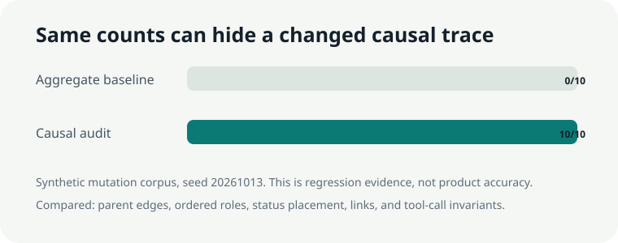

# AgentTrace Canary

[](https://github.com/Ikteder/agenttracecanary/actions/workflows/verify.yml)

AgentTrace Canary is an offline structural regression check for AI agent traces. It compares baseline and candidate OTLP JSON by causal shape, so a trace can fail even when both runs contain the same numbers of agents, model steps, tools, successes, and errors.



## Why it exists

Instrumentation and orchestration changes can move a tool under the wrong agent, flatten a nested agent, attach an error to the wrong step, or leave a span without a parent. Aggregate dashboards can still look unchanged.

AgentTrace Canary gives maintainers a small CI boundary for deterministic agent evaluations:

- reads exported OTLP JSON locally;
- pairs traces through an explicit `agenttrace.case.id`;
- ignores trace IDs, span IDs, and absolute timestamp offsets;
- compares parentage, ordered semantic roles, status placement, and optional typed links;
- checks one-root, valid-parent, acyclic-ancestry, time-containment, tool-ancestry, and unique tool-call-ID invariants;
- writes deterministic JSON, standalone HTML, and SVG evidence without sending trace data anywhere.

It is not a collector, dashboard, standards validator, or model-quality evaluator.

## Evidence

The checked-in `agent-trace-mutations-v1` corpus contains ten authored changes that preserve the aggregate role multiset and total status counts.

| Method | Changed cases flagged | What it compares |
|---|---:|---|
| Aggregate-only baseline | 0 / 10 | Semantic-role counts and total status counts |
| AgentTrace Canary | 10 / 10 | Causal shape plus local trace invariants |

Nine cases change the normalized tree. The duplicate-call-ID and interval checks also demonstrate why local invariants must supplement a tree digest. The candidate run produced 14 findings across all ten cases. A safe comparison with different IDs and shifted absolute clocks produced zero findings.

These results describe the included synthetic corpus. They do not establish production defect detection, standards compliance, or superiority to any observability product.

Open the [standalone mutation report](artifacts/mutation-report.html) or inspect the [raw JSON evidence](artifacts/mutation-report.json).

## Quick start

AgentTrace Canary has no runtime dependencies.

```powershell
python -m venv .venv
.\.venv\Scripts\python -m pip install -e .
```

Compare two exports:

```powershell
agenttracecanary baseline.otlp.json candidate.otlp.json `
  --output report.json `
  --html report.html `
  --svg comparison.svg
```

Exit codes are part of the interface:

- `0`: candidate causal structure matches the baseline;
- `1`: one or more regressions or invariant failures were found;
- `2`: input, schema, or path validation failed.

On macOS or Linux, use normal shell line continuations or one line.

## Input contract

Inputs use OTLP JSON `resourceSpans`, `scopeSpans`, and `spans`. Every logical case must have exactly one `agenttrace.case.id` value somewhere in its trace. The value can be attached to a root span, resource, or scope because OTLP attributes are merged for matching.

The semantic role is derived from:

- `gen_ai.operation.name`;
- `gen_ai.agent.name` for `invoke_agent`;
- `gen_ai.workflow.name` for `invoke_workflow`;
- `gen_ai.tool.name` for `execute_tool`;
- `openinference.span.kind` or span name as a fallback.

`gen_ai.tool.call.id` is checked for duplicate execution spans. Optional span links use `gen_ai.relationship.type` when present; otherwise they are treated as generic links. That relationship attribute is not claimed as a stable standard.

## Normalization

```text
OTLP baseline + candidate
          |
          v
 strict parse and case pairing
          |
          v
 semantic roles + parent tree + relative sibling order
          |                         |
          |                         +--> local invariant checks
          v
 canonical shape digest
          |
          v
 JSON evidence + static HTML + verified SVG
```

Raw attributes, prompts, outputs, absolute timestamps, and identifiers are not written into the report. They still remain in the user's input files.

## Reference landscape

- [OpenTelemetry GenAI semantic conventions](https://github.com/open-telemetry/semantic-conventions-genai) define development-stage agent, workflow, and tool spans. [Issue 3575](https://github.com/open-telemetry/semantic-conventions/issues/3575) describes the missing generic grouping and typed-relationship problem.
- [OpenInference](https://github.com/Arize-ai/openinference) defines interoperable AI span kinds and tool-call linkage. Its instrumentors solve collection, not baseline structural regression.
- [Langfuse](https://github.com/langfuse/langfuse) provides mature tracing and evaluation. [Issue 9293](https://github.com/langfuse/langfuse/issues/9293) is a concrete example of a visible tool call appearing in the wrong agent-loop position.
- [Data Validation for Machine Learning](https://research.google/pubs/data-validation-for-machine-learning/), found through [Applied ML](https://github.com/eugeneyan/applied-ml), informed the boundary-comparison pattern. No Google production result is claimed as reproduced.

The [dated reference review](docs/notes/2026-10-13-reference-review.md) records source snapshots, activity, licenses, contribution rules, rejected alternatives, and the impact gate.

## Verification

```powershell
.\.venv\Scripts\python -m pytest
.\.venv\Scripts\python -m ruff check .
.\.venv\Scripts\python -m ruff format --check .
.\.venv\Scripts\python scripts\generate_corpus.py
.\.venv\Scripts\python scripts\verify_evidence.py
.\.venv\Scripts\python -m build
```

Public CI repeats tests, lint, format, exact fixture regeneration, build, evidence assertions, SVG parsing, and the README style check on Python 3.10, 3.12, and 3.14.

## Data, models, and cost

All fixtures are authored synthetic data under MIT. No external dataset, language model, embedding service, API, or paid provider is used. Actual provider cost for the published run is USD 0.00.

## Limitations

- Version 0.1 expects deterministic fixture traces. Relative sibling order can vary legitimately under concurrency.
- OTLP producers can omit spans through sampling, failure, or instrumentation gaps. A match does not prove execution completeness.
- The parser covers the OTLP JSON fields needed by this slice, not every protobuf JSON edge case or vendor extension.
- Case IDs must be added by the evaluation harness.
- Dynamic agent and tool names can create intended shape changes unless fixtures normalize them before export.
- Reports do not include raw attributes, but input files can still contain sensitive prompts, outputs, and metadata.
- The synthetic corpus is implementation-aligned. No third-party production trace set or false-positive study is included.

## Best next improvement

Add an explicit partial-order policy for concurrent siblings, then validate it against independently produced OpenTelemetry and OpenInference fixture exports from two real agent frameworks. Preserve the current offline corpus as the non-paid CI path.

## Project records

- [Approved specification](docs/superpowers/specs/2026-10-13-agenttracecanary-v0.1.md)
- [Reference review and impact gate](docs/notes/2026-10-13-reference-review.md)
- [Normalization decision](docs/decisions/2026-10-13-causal-shape-normalization.md)
- [Dataset card](docs/datasets/agent-trace-mutations-v1.md)
- [Model and provider card](docs/models/2026-10-13-model-provider-card.md)
- [Verification record](docs/experiments/2026-10-13-verification.md)

## License and affiliation

Released under the [MIT License](LICENSE). Upstream projects retain their own licenses. No upstream source code or fixtures were copied. AgentTrace Canary is not affiliated with OpenTelemetry, OpenInference, Arize, or Langfuse.
